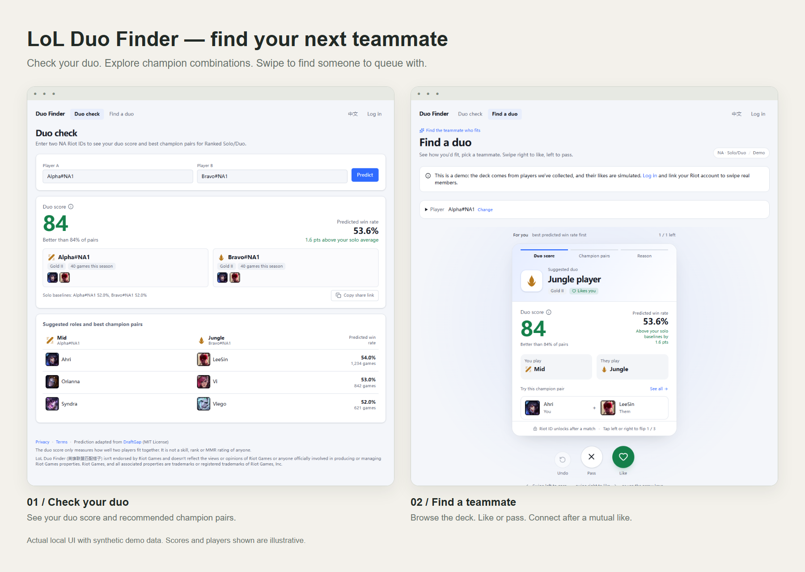

# LoL Duo Finder

A teammate finder for League of Legends players on NA. Check how two players fit together, explore champion combinations, and find someone to queue with — from match history to a mutual like.



*Actual website UI with synthetic demo data. The players and scores above are illustrative.*

- **Check a duo (`/`)** — enter two Riot IDs to see a duo score, predicted win rate, suggested positions, and recommended champion pairs. Copy a link to share the result.
- **Find a teammate (`/find`)** — browse cards ranked by predicted win rate, inspect champion combinations, and like or pass. Visitors can try a browser-local demo; verified, opted-in members can discover other members.
- **Connect after a mutual like** — Riot IDs and contact details stay hidden on discovery cards until both members like each other. See mutual likes and games played together, with optional Discord notifications.
- **Make it personal** — add a bio, languages, voice preferences, and play times; filter the deck and turn on a temporary “Looking now” status.
- **Explore a player (`/player/[slug]`)** — view a player's profile and recent games. Players with fewer than 20 ranked games can select their champions and positions manually.

The interface supports English and Chinese. Match statistics are scoped to **NA Ranked Solo/Duo (queue 420)**.

## How the score works

The prediction model combines player champion proficiency, champion strength, and champion-pair synergy using an Elo-based approach adapted from [DraftGap](https://github.com/vigovlugt/draftgap).

The **duo score** expresses the predicted win rate as a percentile of a fitted distribution of eligible pairs in the recommendation pool with the same two positions. A score of 50 represents a typical pair in that distribution. It measures how two players fit together; it is not an individual skill or hidden MMR rating, and an 84 duo score does not mean an 84% chance of winning.

Pair statistics cover any two players on the same team, whether they queued together or were matched by the game. See the [model decision](docs/adr/0001-draftgap-style-rating-model.md) and [pair definition](docs/adr/0002-pair-means-any-teammates.md).

## Built with

| Layer | Stack |
| --- | --- |
| Website | Next.js 15, React 19, TypeScript, Tailwind CSS 4, Radix UI |
| Authentication | Auth.js with Discord login; Riot account ownership verified through an icon challenge |
| Application data | Drizzle ORM; PGlite locally, Postgres in production |
| Match data and predictions | Python, FastAPI, Riot API; SQLite locally or Postgres in production |
| Verification | pytest and Playwright |
| Deployment | Vercel website, Fly.io Python API, Neon Postgres |

## Run locally

Prerequisites: Python 3.11+, [uv](https://docs.astral.sh/uv/), and Node.js 20.9+ with npm.

### 1. Install and configure

From the repository root:

```sh
uv sync
cp .env.example .env
cd web
npm ci
cp .env.example .env.local
npx auth secret
cd ..
```

For live Riot lookups, set `RIOT_API_KEY` in the root `.env`. Configure Discord credentials in `web/.env.local` for Discord login, or use the included local-only `AUTH_DEV_LOGIN=1` option. Local application data uses PGlite when `DATABASE_URL` is empty.

### 2. Start the Python API

For a reproducible demo without a Riot API key, first create a separate synthetic match database:

```sh
uv run python data/fake_riot.py demo.sqlite
```

Then run the API with these environment variables:

```sh
# macOS / Linux
DUO_DB=demo.sqlite DUO_FAKE_RIOT=1 uv run uvicorn api:app --app-dir data --port 8000
```

```powershell
# Windows PowerShell
$env:DUO_DB = "demo.sqlite"
$env:DUO_FAKE_RIOT = "1"
uv run uvicorn api:app --app-dir data --port 8000
```

To use real data, omit `DUO_FAKE_RIOT` and point `DUO_DB` to your collected match database. Score calibration is computed in the background when needed.

### 3. Start the website

In a second terminal:

```sh
cd web
npm run dev
```

Open [localhost:3000](http://localhost:3000). In synthetic demo mode, try `Alpha#NA1` and `Bravo#NA1` on the duo check page, or `Alpha#NA1` on the teammate finder.

The website forwards match-data requests to the Python API at `http://127.0.0.1:8000` by default. See [deployment instructions](docs/deploy.md) for production configuration, secrets, and database setup. Keep fake Riot data and development login disabled in production.

## Project map

```text
data/              Riot collection, statistics, prediction API, and Python tests
web/app/           Next.js pages and API routes
web/components/    Duo results, player profiles, and swipe UI
web/lib/           App database, authentication helpers, and deck logic
web/e2e/           Playwright scenarios
web/drizzle/       Application database migrations
docs/adr/          Architecture and product decisions
```

Run backend checks with `uv run pytest` and frontend type checks with `cd web && npm run typecheck`. The Playwright suite (`npm run test:e2e` from `web/`) starts isolated services with synthetic data; its server commands currently require a POSIX-compatible environment.

For more context, see the [product specification](docs/PRD-v2.md), [project terminology](CONTEXT.md), and [deployment guide](docs/deploy.md).

---

LoL Duo Finder isn't endorsed by Riot Games and doesn't reflect the views or opinions of Riot Games or anyone officially involved in producing or managing Riot Games properties. Riot Games, and all associated properties are trademarks or registered trademarks of Riot Games, Inc.

