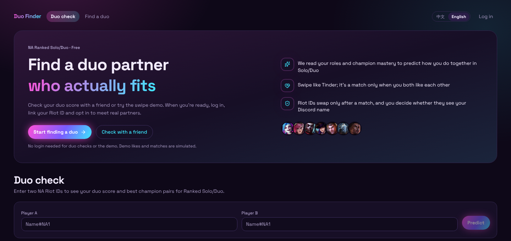
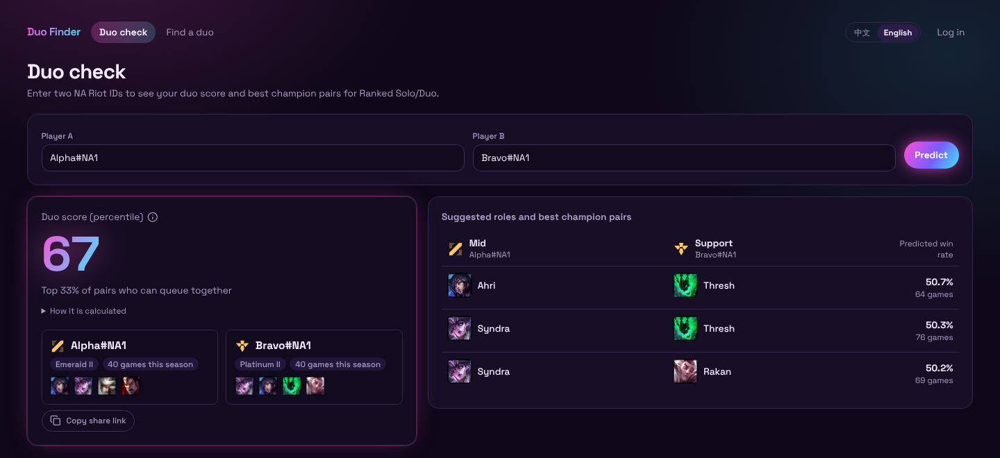
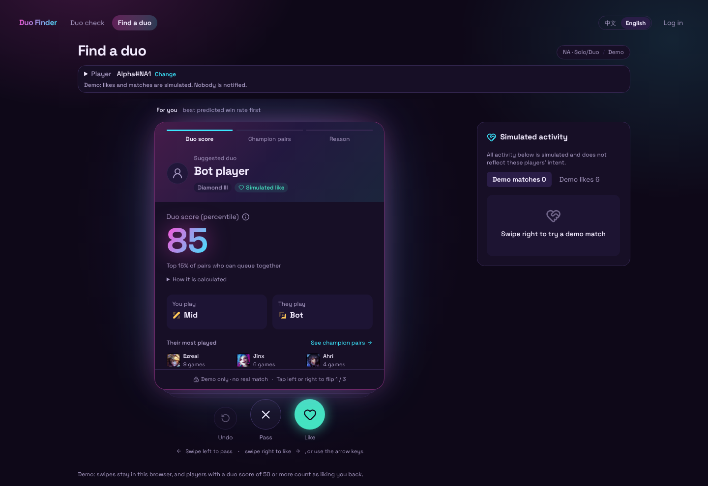
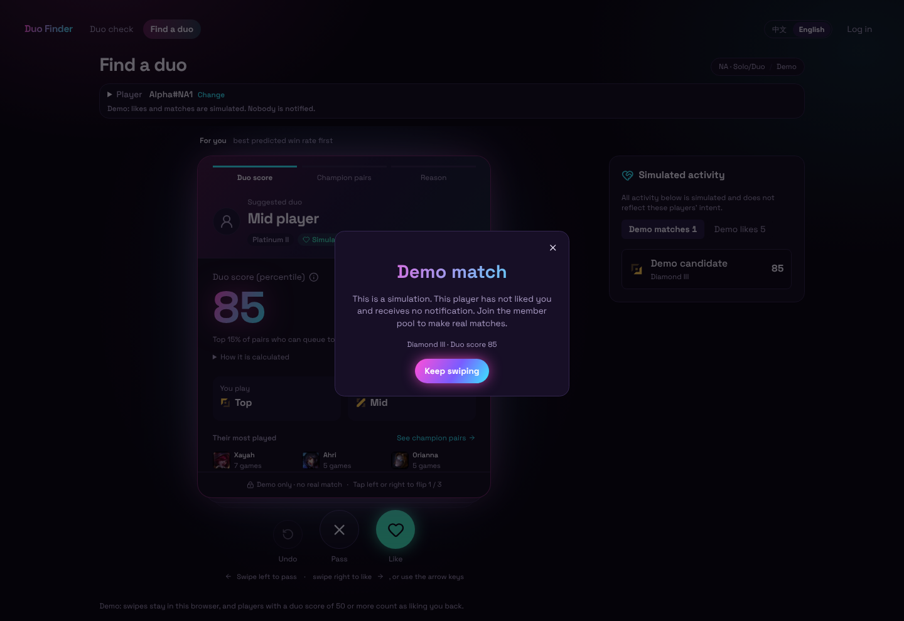
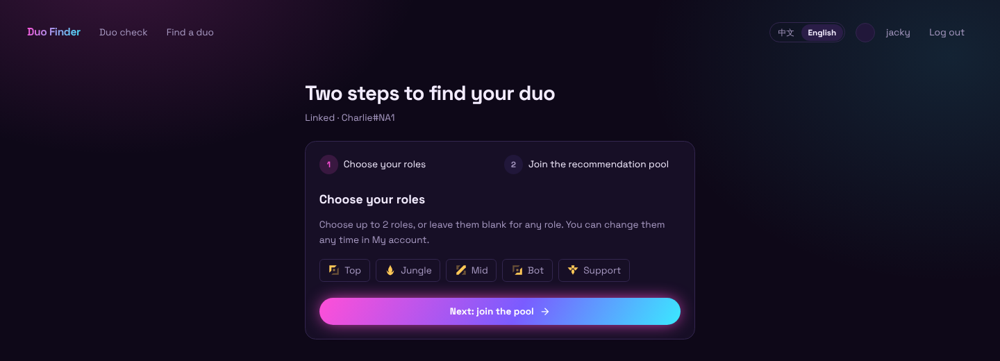
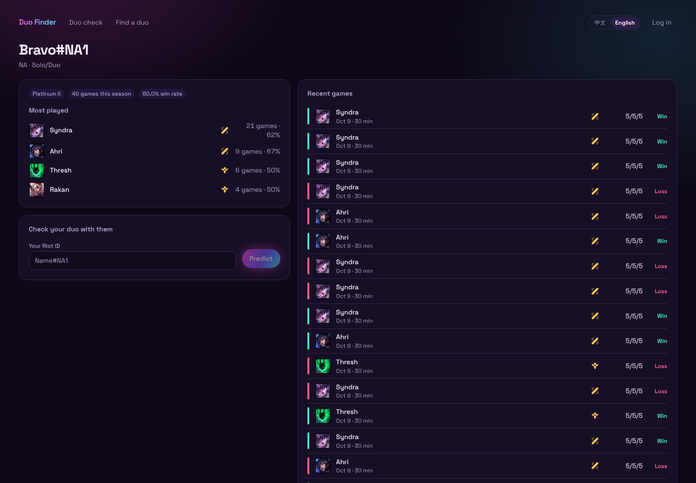
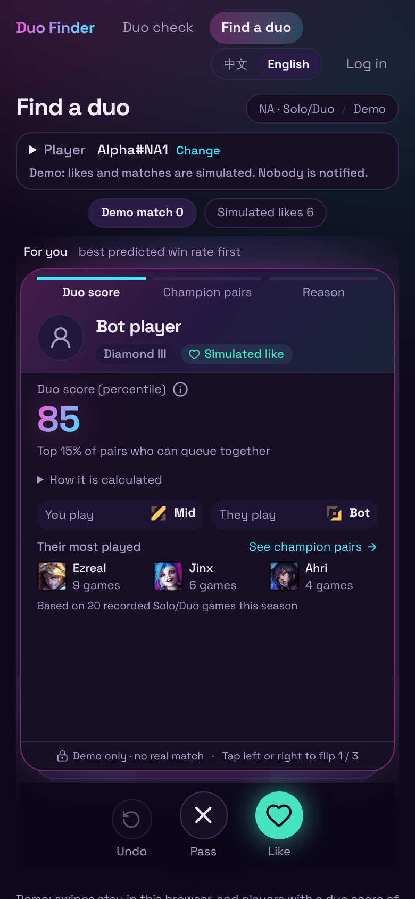

# LoL Duo Finder

A teammate finder for League of Legends players on NA. Check how two players fit together, explore champion combinations, and swipe to find someone to queue with, from match history to a mutual like.



*Screenshots show the actual site running locally on synthetic demo data (`data/fake_riot.py`). Players and scores are illustrative.*

## What's on the site

- **Home and duo check (`/`)**: a product introduction with paths to the swipe deck and a free two-player check. Enter two Riot IDs to see a 0–100 duo score shown as a percentile (“Top 33% of pairs who can queue together”), suggested roles and recommended champion pairs. “How it is calculated” opens the predicted win rate and how far it is above or below your solo average. Cold lookups show player identity and rank first, then actual match-loading progress. Copy a link to share the result.
- **Find a duo (`/find`)**: a swipe deck ranked by predicted win rate. Each card flips through duo score, the other player's most played champions and champion pairs, and reasons; swipe, drag or use the arrow keys to like or pass, and undo your last pass. Visitors get a browser-local demo where every like, match and count is clearly labelled as simulated. Members who link a Riot ID and opt in swipe real members.
- **Getting started (`/welcome`)**: right after linking a Riot ID, a two-step setup asks for up to two roles, then for explicit consent to join the recommendation pool, and drops you into the real deck.
- **Matches**: Riot IDs stay hidden on cards until both members like each other. Matches and “likes you” show next to the deck, with optional Discord DM notifications. Members can block or report, and admins review reports at `/admin`.
- **Player pages (`/player/Name-NA1`)**: rank, most played champions and recent ranked games, with a shortcut to check your duo with that player. Players with fewer than 20 ranked games can pick their champions and roles by hand.
- **Accounts**: log in with Discord, link a Riot ID (marked *Unverified* until Riot Sign On is available, see [ADR-0011](docs/adr/0011-bind-riot-id-unverified-until-rso.md)), choose any summoner icon as your avatar, and add a bio, languages, voice preference, play times and a temporary “Looking now” status.
- **English and Chinese** throughout, switchable from the header, on desktop and phone.

Match statistics are scoped to **NA Ranked Solo/Duo (queue 420)**.

| Duo check | Find a duo |
| --- | --- |
|  |  |

| Demo match | Two-step setup after linking |
| --- | --- |
|  |  |

| Player page | On a phone |
| --- | --- |
|  |  |

## How the score works

The prediction model combines player champion proficiency, champion strength, and champion-pair synergy using an Elo-based approach adapted from [DraftGap](https://github.com/vigovlugt/draftgap).

The **duo score** expresses the predicted win rate as a percentile of a fitted distribution of eligible pairs in the recommendation pool with the same two positions ([ADR-0010](docs/adr/0010-score-within-same-positions.md)). The fitted scale is stored in the database, refitted daily and loaded by the API at startup. A score of 50 represents a typical pair in that distribution. The API's `reasons` give each term's effect in win-rate percentage points compared with leaving that term out. It measures how two players fit together; it is not an individual skill or hidden MMR rating, and an 84 duo score does not mean an 84% chance of winning.

Pair statistics cover any two players on the same team, whether they queued together or were matched by the game. See the [model decision](docs/adr/0001-draftgap-style-rating-model.md) and [pair definition](docs/adr/0002-pair-means-any-teammates.md).

## Built with

| Layer | Stack |
| --- | --- |
| Website | Next.js 15, React 19, TypeScript, Tailwind CSS 4, Radix UI, Motion; “Arcane” neon theme with Space Grotesk |
| Authentication | Auth.js with Discord login; Riot ID linked as unverified until Riot Sign On (RSO) |
| Application data | Drizzle ORM; PGlite locally, Postgres in production |
| Match data and predictions | Python, FastAPI, Riot API; Postgres on Neon (`DATABASE_URL`) or a local SQLite file |
| Verification | pytest and Playwright |
| Deployment | Vercel website, Fly.io Python API, Neon Postgres |

## Run locally

Prerequisites: Python 3.11+, [uv](https://docs.astral.sh/uv/), and Node.js 20.9+ with npm.

### 1. Install and configure

From the repository root:

```sh
uv sync
cp .env.example .env
cd web
npm ci
cp .env.example .env.local
npx auth secret
cd ..
```

For live Riot lookups, set `RIOT_API_KEY` in the root `.env`. Configure Discord credentials in `web/.env.local` for Discord login, or use the included local-only `AUTH_DEV_LOGIN=1` option. Local application data uses PGlite when `DATABASE_URL` is empty.

### 2. Start the Python API

For a reproducible demo without a Riot API key, first create a separate synthetic match database:

```sh
uv run python data/fake_riot.py demo.sqlite
```

Then run the API with these environment variables:

```sh
# macOS / Linux
DUO_DB=demo.sqlite DUO_FAKE_RIOT=1 uv run uvicorn api:app --app-dir data --port 8000
```

```powershell
# Windows PowerShell
$env:DUO_DB = "demo.sqlite"
$env:DUO_FAKE_RIOT = "1"
uv run uvicorn api:app --app-dir data --port 8000
```

To use real data, omit `DUO_FAKE_RIOT` and `DUO_DB`: the API then reads `DATABASE_URL` from the root `.env` (the shared Neon database), or `lol_duo.sqlite` if that is empty. `DUO_DB` can point at any SQLite file or Postgres URL instead. If the database has no fitted score scale yet, the API fits one in the background; to do it up front, run `uv run python data/score_scale.py --db <database>`.

### 3. Start the website

In a second terminal:

```sh
cd web
npm run dev
```

Open [localhost:3000](http://localhost:3000). In synthetic demo mode, try `Alpha#NA1` and `Bravo#NA1` on the duo check page, or `Alpha#NA1` on the teammate finder.

The website forwards match-data requests to the Python API at `http://127.0.0.1:8000` by default. See [deployment instructions](docs/deploy.md) for production configuration, secrets, and database setup. Keep fake Riot data and development login disabled in production.

## Project map

```text
data/              Riot collection, statistics, prediction API, and Python tests
web/app/           Next.js pages and API routes
web/components/    Duo results, player profiles, and swipe UI
web/lib/           App database, authentication helpers, and deck logic
web/e2e/           Playwright scenarios
web/drizzle/       Application database migrations
docs/adr/          Architecture and product decisions
```

Run backend checks with `uv run pytest` and frontend type checks with `cd web && npm run typecheck`. The Playwright suite (`npm run test:e2e` from `web/`) starts isolated services with synthetic data on Windows and POSIX systems. Windows can use the existing uv-synced `.venv`; set `PW_CHANNEL=msedge` to use installed Edge instead of Playwright Chromium. Test databases live in a new temporary directory for each run.

Anonymous first-party funnel milestones and example analysis queries are documented in [analytics](docs/analytics.md). Demo activity is counted separately from real member activity.

For more context, see the [product specification](docs/PRD-v2.md), [project terminology](CONTEXT.md), and [deployment guide](docs/deploy.md).

---

LoL Duo Finder isn't endorsed by Riot Games and doesn't reflect the views or opinions of Riot Games or anyone officially involved in producing or managing Riot Games properties. Riot Games, and all associated properties are trademarks or registered trademarks of Riot Games, Inc.

